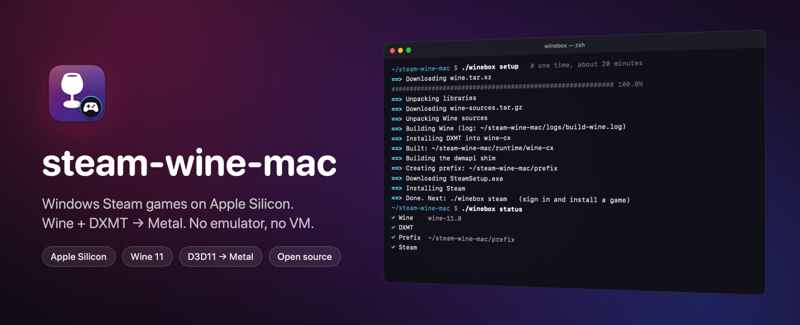
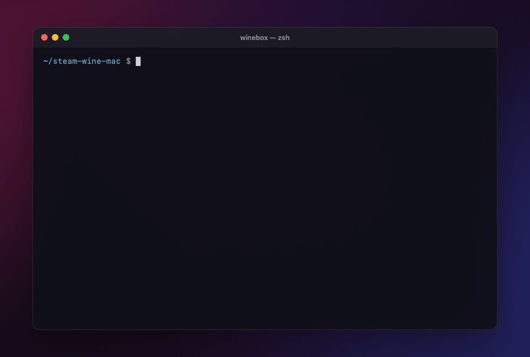
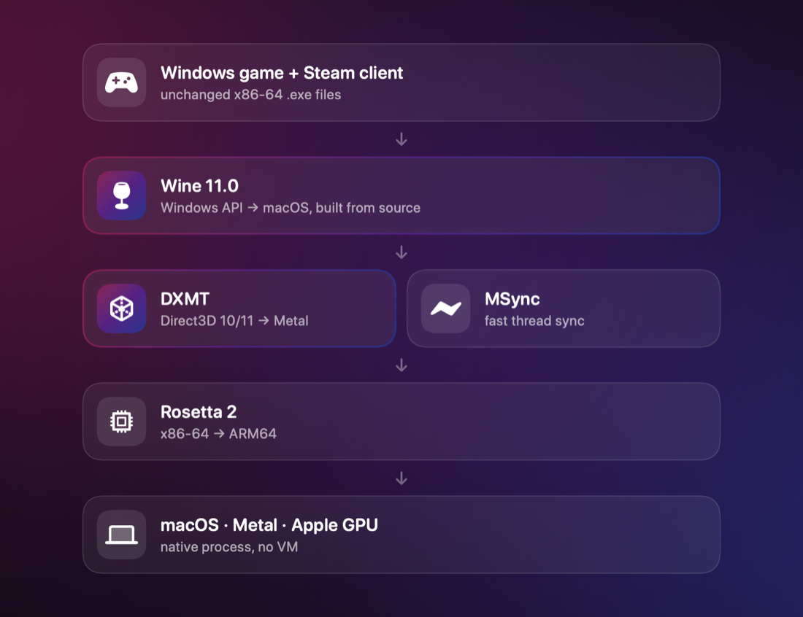

<p align="center">
  
</p>

<p align="center">
  <b>English</b> · <a href="README.ru.md">Русский</a> · <a href="README.zh-CN.md">简体中文</a>
</p>

<p align="center">
  
  
  
  
  
  <a href="LICENSE"></a>
</p>

<p align="center">
  Run the <b>Windows version of Steam</b> — and the games in your library — on Apple Silicon Macs.<br>
  One small script builds Wine from source, adds a Direct3D&nbsp;11&nbsp;→&nbsp;Metal layer and installs Steam into an isolated prefix.<br>
  Free and open source.
</p>

<p align="center">
  
</p>

---

## ⚡ Quick start

```sh
git clone https://github.com/RazinAleksandr/steam-wine-mac.git && cd steam-wine-mac
./winebox setup        # one time, about 20 minutes
./winebox steam        # sign in, install a game
./winebox deadlock     # play (or: ./winebox play <appid>)
```

> [!NOTE]
> Tested on a MacBook Pro M4 Pro, macOS 15.7, with **Deadlock**. Other games and machines are untested so far — [reports are welcome](https://github.com/RazinAleksandr/steam-wine-mac/issues).

## ✨ Why it's nice

|  |  |
|---|---|
| 🚫 **No emulator, no VM** | The Windows program runs as a normal macOS process; its calls are translated on the fly. |
| 🎮 **The real Steam client** | Your own account, library, downloads and updates — exactly like on Windows. |
| 🖥️ **Direct3D 11 → Metal** | [DXMT](https://github.com/3Shain/dxmt) turns DirectX 10/11 into Metal for the Apple GPU. |
| 📦 **Isolated** | Everything lives in this folder: runtime, prefix (C: drive), logs. Delete the folder and it's gone. |
| 🔁 **Reuse downloads** | `import` clones a game from another Windows Steam library on the same Mac — APFS copy-on-write, no re-download, no extra space. |
| 🖱️ **Double-click launchers** | `Steam (winebox).app` and `Deadlock.app` — drag them to the Dock. |

## 📋 Requirements

- Apple Silicon Mac, macOS 14 or newer
- Rosetta 2: `softwareupdate --install-rosetta --agree-to-license`
- [Homebrew](https://brew.sh) and the build tools:
  ```sh
  brew install zig mingw-w64 bison freetype gnutls sdl2 molten-vk
  ```
- About **5 GB** of disk for the toolchain and runtime, plus your games
- A Steam account that owns the games you want to play

## 🧰 Commands

| Command | What it does |
|:--|:--|
| `./winebox setup` | Everything from scratch: libraries, Wine build, DXMT, prefix, Steam |
| `./winebox steam` | Start Steam |
| `./winebox play <appid> [args]` | Start a game by its Steam appid, e.g. `./winebox play 1422450 -dx11` |
| `./winebox deadlock` | Shortcut for the Deadlock example |
| `./winebox stop` | Stop every Wine process of the prefix |
| `./winebox status` | Show what is installed |
| `./winebox run <exe> [args]` | Run any `.exe` in the prefix (`winecfg`, `regedit`, …) |
| `./winebox import <steamapps> <appid>` | Clone an already-downloaded game from another Windows Steam library on the same Mac |

`Deadlock.app` and `Steam (winebox).app` are double-click launchers for the same commands. Drag them to the Dock — they must stay next to the `winebox` script.

## ⚙️ How it works

<p align="center"></p>

| Layer | Component |
|:--|:--|
| Windows API | Wine 11.0, built from source by `build/build-wine.sh` |
| Direct3D 10/11 → Metal | [DXMT](https://github.com/3Shain/dxmt) |
| Thread synchronisation | MSync |
| x86-64 → ARM64 | Rosetta 2 |
| Steam UI | software rendering plus a small shim (`shim/`), see below |
| C: drive and registry | `prefix/` |

<details>
<summary><b>The Steam UI shim</b> — why the Steam window isn't black</summary>

Steam's interface is Chromium. By default Chromium draws from a separate GPU process into the main process's window, which Wine on macOS cannot do — the window stays black. `shim/shim.c` is a tiny `dwmapi.dll` proxy that puts `--in-process-gpu` on the command line of `steamwebhelper.exe` before Chromium starts.
</details>

## 🎯 Which games work

Only Deadlock is verified. From how the stack is built:

| | |
|:--|:--|
| ✅ **Likely to work** | DirectX 10 and 11 games |
| ⚠️ **Uncertain** | DirectX 9 (Wine's own translator needs OpenGL, which this build leaves out) · Vulkan games (MoltenVK) · games that play video files (built without GStreamer) · .NET launchers (no Mono) |
| ❌ **Will not work** | DirectX 12 games · games protected by kernel-level anti-cheat |

> [!TIP]
> If a game shows a black screen, add `-dx11` to its launch options.

## 🩺 Troubleshooting

<details><summary><b>Two Steam icons in the Dock</b></summary>

That is one Steam: `steam.exe` and its UI process each get an icon.
</details>

<details><summary><b>Something is stuck</b></summary>

`./winebox stop`, then start again.
</details>

<details><summary><b>Where are the logs?</b></summary>

`logs/steam.log` holds the output of Steam and the games it starts. `WINEDEBUG=fixme-all ./winebox steam` makes it verbose.
</details>

<details><summary><b>Black Steam window</b></summary>

`tools/cefshot.py` captures what Chromium rendered internally (start Steam with `-cef-enable-debugging`).
</details>

## 🧹 Uninstall

```sh
./winebox stop && rm -rf runtime prefix logs build/obj build/sources
```

## 📦 Third-party components

This repository contains only scripts and the shim. `./winebox setup` downloads the rest from its publishers; nothing below is redistributed here.

| Component | License | Source |
|:--|:--|:--|
| Wine 11.0 source tree with macOS patches (winemac exports used by DXMT, MSync) | LGPL-2.1 | CodeWeavers' open-source release |
| Prebuilt Wine package, used for its FreeType, GnuTLS, SDL2 and MoltenVK libraries | LGPL-2.1 and others | Gcenx/macOS_Wine_builds |
| DXMT v0.80 | MIT | 3Shain/dxmt |
| Steam client | proprietary | Valve, downloaded from Valve's servers |

## ⚖️ Disclaimer

This project is not affiliated with or endorsed by Valve, Apple or any game publisher. Steam, Deadlock and other names are trademarks of their owners. You need your own Steam account and licences for the games you run. Running Windows games through a translation layer is not officially supported by their publishers; use it at your own risk.

## 📄 License

MIT — see [LICENSE](LICENSE).
