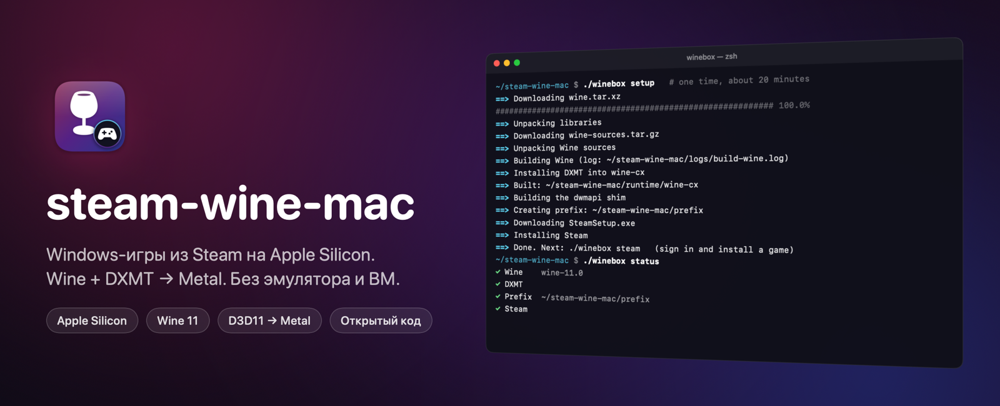
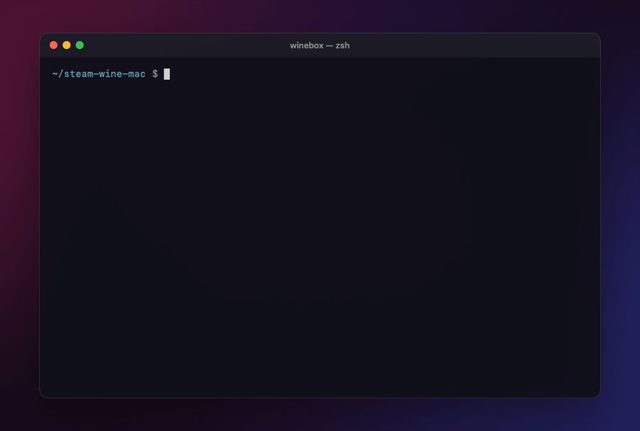
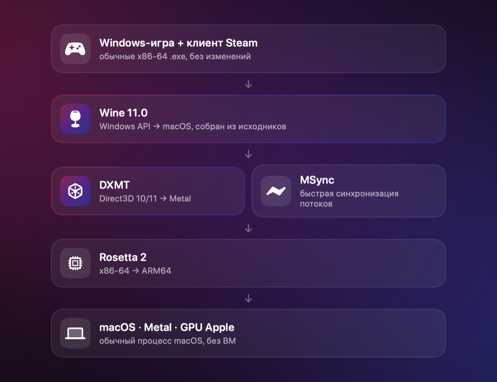

<p align="center">
  
</p>

<p align="center">
  <a href="README.md">English</a> · <b>Русский</b> · <a href="README.zh-CN.md">简体中文</a>
</p>

<p align="center">
  
  
  
  
  <a href="LICENSE"></a>
</p>

<p align="center">
  Запускайте <b>Windows-версию Steam</b> и игры из своей библиотеки на Mac с Apple Silicon.<br>
  Один небольшой скрипт собирает Wine из исходников, добавляет слой Direct3D&nbsp;11&nbsp;→&nbsp;Metal и ставит Steam в изолированный префикс.<br>
  Бесплатно и с открытым кодом.
</p>

<p align="center">
  
</p>

---

## ⚡ Быстрый старт

```sh
git clone https://github.com/RazinAleksandr/steam-wine-mac.git && cd steam-wine-mac
./winebox setup        # один раз, около 20 минут
./winebox steam        # войти в аккаунт, установить игру
./winebox deadlock     # играть (или: ./winebox play <appid>)
```

> [!NOTE]
> Проверено на MacBook Pro M4 Pro, macOS 15.7, с игрой **Deadlock**. Другие игры и компьютеры пока не проверялись — [отчёты приветствуются](https://github.com/RazinAleksandr/steam-wine-mac/issues).

## ✨ Чем хорош

|  |  |
|---|---|
| 🚫 **Без эмулятора и виртуалки** | Windows-программа работает как обычный процесс macOS, её вызовы переводятся на лету. |
| 🎮 **Настоящий клиент Steam** | Свой аккаунт, библиотека, загрузки и обновления — как на Windows. |
| 🖥️ **Direct3D 11 → Metal** | [DXMT](https://github.com/3Shain/dxmt) переводит DirectX 10/11 в Metal для GPU Apple. |
| 📦 **Изолированно** | Всё лежит в этой папке: среда, префикс (диск C:), логи. Удалили папку — ничего не осталось. |
| 🔁 **Без повторных загрузок** | `import` клонирует игру из другой Windows-библиотеки Steam на этом же Mac — копирование APFS, без загрузки и лишнего места. |
| 🖱️ **Ярлыки для запуска** | `Steam (winebox).app` и `Deadlock.app` — перетащите в Dock. |

## 📋 Что нужно

- Mac с Apple Silicon, macOS 14 или новее
- Rosetta 2: `softwareupdate --install-rosetta --agree-to-license`
- [Homebrew](https://brew.sh) и инструменты сборки:
  ```sh
  brew install zig mingw-w64 bison freetype gnutls sdl2 molten-vk
  ```
- Около **5 ГБ** на диске для инструментов и среды, плюс место под игры
- Аккаунт Steam с купленными играми

## 🧰 Команды

| Команда | Что делает |
|:--|:--|
| `./winebox setup` | Всё с нуля: библиотеки, сборка Wine, DXMT, префикс, Steam |
| `./winebox steam` | Запустить Steam |
| `./winebox play <appid> [args]` | Запустить игру по её appid в Steam, например `./winebox play 1422450 -dx11` |
| `./winebox deadlock` | Короткая команда для примера с Deadlock |
| `./winebox stop` | Остановить все процессы Wine этого префикса |
| `./winebox status` | Показать, что установлено |
| `./winebox run <exe> [args]` | Запустить любой `.exe` в префиксе (`winecfg`, `regedit`, …) |
| `./winebox import <steamapps> <appid>` | Клонировать уже скачанную игру из другой Windows-библиотеки Steam на этом Mac |

`Deadlock.app` и `Steam (winebox).app` запускают те же команды двойным кликом. Их можно перетащить в Dock — но они должны лежать рядом со скриптом `winebox`.

## ⚙️ Как это работает

<p align="center"></p>

| Слой | Компонент |
|:--|:--|
| Windows API | Wine 11.0, собирается из исходников скриптом `build/build-wine.sh` |
| Direct3D 10/11 → Metal | [DXMT](https://github.com/3Shain/dxmt) |
| Синхронизация потоков | MSync |
| x86-64 → ARM64 | Rosetta 2 |
| Интерфейс Steam | программная отрисовка и маленькая прокладка (`shim/`), см. ниже |
| Диск C: и реестр | `prefix/` |

<details>
<summary><b>Прокладка для интерфейса Steam</b> — почему окно Steam не чёрное</summary>

Интерфейс Steam — это Chromium. По умолчанию Chromium рисует из отдельного GPU-процесса в окно основного процесса, а Wine на macOS так не умеет — окно остаётся чёрным. `shim/shim.c` — крошечная прокладка `dwmapi.dll`, которая добавляет `--in-process-gpu` в командную строку `steamwebhelper.exe` до запуска Chromium.
</details>

## 🎯 Какие игры работают

Проверен только Deadlock. Исходя из устройства стека:

| | |
|:--|:--|
| ✅ **Скорее всего работают** | Игры на DirectX 10 и 11 |
| ⚠️ **Под вопросом** | DirectX 9 (переводчику Wine нужен OpenGL, которого в этой сборке нет) · игры на Vulkan (MoltenVK) · игры с видеороликами (сборка без GStreamer) · лаунчеры на .NET (нет Mono) |
| ❌ **Не работают** | Игры на DirectX 12 · игры с античитом на уровне ядра |

> [!TIP]
> Если игра показывает чёрный экран, добавьте `-dx11` в её параметры запуска.

## 🩺 Если что-то не так

<details><summary><b>Два значка Steam в Dock</b></summary>

Это один Steam: свой значок получают `steam.exe` и процесс его интерфейса.
</details>

<details><summary><b>Что-то зависло</b></summary>

`./winebox stop`, затем запустите снова.
</details>

<details><summary><b>Где логи?</b></summary>

В `logs/steam.log` — вывод Steam и запущенных из него игр. `WINEDEBUG=fixme-all ./winebox steam` включает подробный режим.
</details>

<details><summary><b>Чёрное окно Steam</b></summary>

`tools/cefshot.py` снимает то, что Chromium отрисовал внутри (запускайте Steam с `-cef-enable-debugging`).
</details>

## 🧹 Удаление

```sh
./winebox stop && rm -rf runtime prefix logs build/obj build/sources
```

## 📦 Сторонние компоненты

В репозитории только скрипты и прокладка. Остальное `./winebox setup` скачивает у издателей; ничего из списка ниже здесь не распространяется.

| Компонент | Лицензия | Источник |
|:--|:--|:--|
| Исходники Wine 11.0 с патчами для macOS (экспорты winemac для DXMT, MSync) | LGPL-2.1 | открытый релиз CodeWeavers |
| Готовая сборка Wine — ради библиотек FreeType, GnuTLS, SDL2 и MoltenVK | LGPL-2.1 и другие | Gcenx/macOS_Wine_builds |
| DXMT v0.80 | MIT | 3Shain/dxmt |
| Клиент Steam | проприетарный | Valve, скачивается с серверов Valve |

## ⚖️ Отказ от ответственности

Проект не связан с Valve, Apple или издателями игр и не одобрен ими. Steam, Deadlock и другие названия — товарные знаки их владельцев. Нужен собственный аккаунт Steam и лицензии на игры. Запуск Windows-игр через слой трансляции официально не поддерживается их издателями; используйте на свой риск.

## 📄 Лицензия

MIT — см. [LICENSE](LICENSE).
