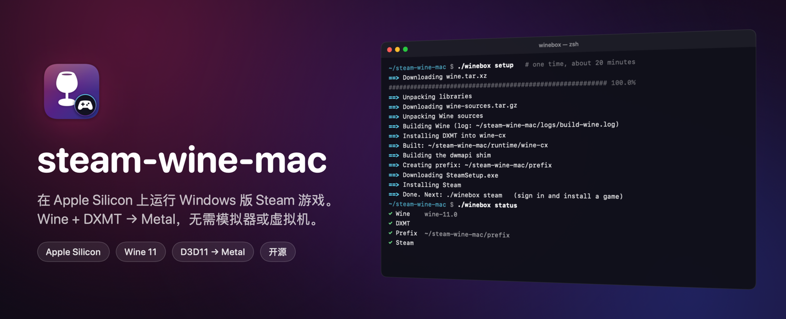
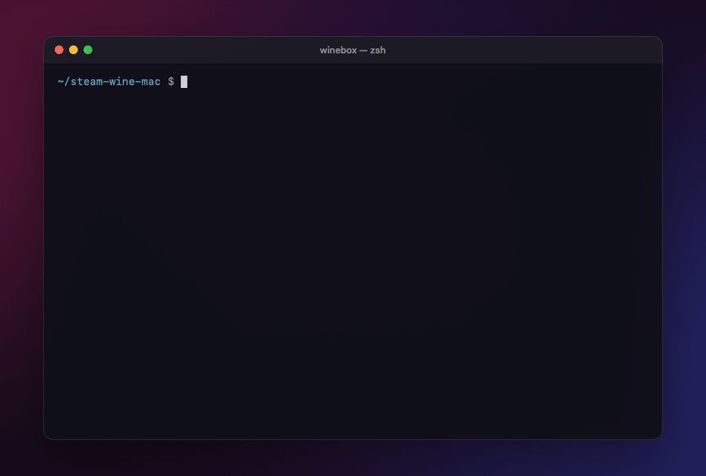
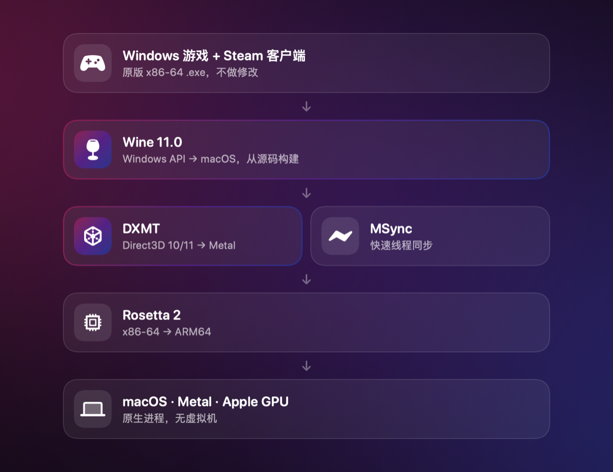

<p align="center">
  
</p>

<p align="center">
  <a href="README.md">English</a> · <a href="README.ru.md">Русский</a> · <b>简体中文</b>
</p>

<p align="center">
  <a href="https://github.com/RazinAleksandr/steam-wine-mac/releases/latest"></a>
  
  
  
  
  <a href="LICENSE"></a>
</p>

<p align="center">
  在 Apple Silicon Mac 上运行 <b>Windows 版 Steam</b> 以及你库中的游戏。<br>
  一个小脚本从源码构建 Wine，加入 Direct3D&nbsp;11&nbsp;→&nbsp;Metal 转换层，并把 Steam 安装到独立的前缀中。<br>
  免费且开源。
</p>

<p align="center">
  
</p>

---

## ⚡ 快速开始

```sh
git clone https://github.com/RazinAleksandr/steam-wine-mac.git && cd steam-wine-mac
./winebox setup        # 仅需一次，约 20 分钟
./winebox steam        # 登录并安装游戏
./winebox deadlock     # 开玩（或：./winebox play <appid>）
```

> [!NOTE]
> 已在 MacBook Pro M4 Pro、macOS 15.7 上用 **Deadlock** 测试。其他游戏和机型尚未测试——[欢迎反馈](https://github.com/RazinAleksandr/steam-wine-mac/issues)。

## ✨ 亮点

|  |  |
|---|---|
| 🚫 **无模拟器，无虚拟机** | Windows 程序作为普通 macOS 进程运行，其调用被实时转换。 |
| 🎮 **真正的 Steam 客户端** | 使用你自己的账号、游戏库、下载与更新——和在 Windows 上一样。 |
| 🖥️ **Direct3D 11 → Metal** | [DXMT](https://github.com/3Shain/dxmt) 把 DirectX 10/11 转换为 Apple GPU 上的 Metal。 |
| 📦 **完全隔离** | 运行环境、前缀（C 盘）、日志都在这个文件夹里。删掉文件夹即可彻底移除。 |
| 🔁 **复用已下载的游戏** | `import` 可从同一台 Mac 上的另一个 Windows Steam 库克隆游戏——APFS 写时复制，无需重新下载，不占额外空间。 |
| 🖱️ **双击启动** | `Steam (winebox).app` 和 `Deadlock.app`——可拖到程序坞。 |

## 📋 系统要求

- Apple Silicon Mac，macOS 14 或更高版本
- Rosetta 2：`softwareupdate --install-rosetta --agree-to-license`
- [Homebrew](https://brew.sh) 及构建工具：
  ```sh
  brew install zig mingw-w64 bison freetype gnutls sdl2 molten-vk
  ```
- 约 **5 GB** 磁盘空间用于工具链和运行环境，另加游戏所需空间
- 拥有你想玩的游戏的 Steam 账号

## 🧰 命令

| 命令 | 作用 |
|:--|:--|
| `./winebox setup` | 从零开始：库、构建 Wine、DXMT、前缀、Steam |
| `./winebox steam` | 启动 Steam |
| `./winebox play <appid> [args]` | 按 Steam appid 启动游戏，例如 `./winebox play 1422450 -dx11` |
| `./winebox deadlock` | Deadlock 示例的快捷命令 |
| `./winebox stop` | 停止该前缀的所有 Wine 进程 |
| `./winebox status` | 显示安装状态 |
| `./winebox run <exe> [args]` | 在前缀中运行任意 `.exe`（`winecfg`、`regedit` 等） |
| `./winebox import <steamapps> <appid>` | 从同一台 Mac 上另一个 Windows Steam 库克隆已下载的游戏 |

`Deadlock.app` 和 `Steam (winebox).app` 可双击运行相同的命令。可以拖到程序坞，但它们必须和 `winebox` 脚本放在同一目录。

## ⚙️ 工作原理

<p align="center"></p>

| 层 | 组件 |
|:--|:--|
| Windows API | Wine 11.0，由 `build/build-wine.sh` 从源码构建 |
| Direct3D 10/11 → Metal | [DXMT](https://github.com/3Shain/dxmt) |
| 线程同步 | MSync |
| x86-64 → ARM64 | Rosetta 2 |
| Steam 界面 | 软件渲染加一个小垫片（`shim/`），见下文 |
| C 盘与注册表 | `prefix/` |

<details>
<summary><b>Steam 界面垫片</b>——为什么 Steam 窗口不是黑屏</summary>

Steam 的界面基于 Chromium。默认情况下 Chromium 由独立的 GPU 进程绘制到主进程窗口，而 macOS 上的 Wine 做不到——窗口会一直是黑的。`shim/shim.c` 是一个很小的 `dwmapi.dll` 代理，在 Chromium 启动前为 `steamwebhelper.exe` 的命令行加上 `--in-process-gpu`。
</details>

## 🎯 哪些游戏能玩

目前只验证了 Deadlock。根据技术栈推断：

| | |
|:--|:--|
| ✅ **很可能可以** | DirectX 10 和 11 游戏 |
| ⚠️ **不确定** | DirectX 9（Wine 自带的转换需要 OpenGL，本构建未包含）· Vulkan 游戏（MoltenVK）· 播放视频文件的游戏（未包含 GStreamer）· .NET 启动器（无 Mono） |
| ❌ **无法运行** | DirectX 12 游戏 · 使用内核级反作弊的游戏 |

> [!TIP]
> 如果游戏黑屏，请在启动选项中加入 `-dx11`。

## 🩺 故障排除

<details><summary><b>程序坞里有两个 Steam 图标</b></summary>

其实只有一个 Steam：`steam.exe` 和它的界面进程各有一个图标。
</details>

<details><summary><b>程序卡住了</b></summary>

先执行 `./winebox stop`，再重新启动。
</details>

<details><summary><b>日志在哪里？</b></summary>

`logs/steam.log` 记录 Steam 及其启动的游戏的输出。`WINEDEBUG=fixme-all ./winebox steam` 可输出更详细的信息。
</details>

<details><summary><b>Steam 窗口是黑的</b></summary>

`tools/cefshot.py` 可以截取 Chromium 内部渲染的内容（用 `-cef-enable-debugging` 启动 Steam）。
</details>

## 🧹 卸载

```sh
./winebox stop && rm -rf runtime prefix logs build/obj build/sources
```

## 📦 第三方组件

本仓库只包含脚本和垫片。其余部分由 `./winebox setup` 从各发布方下载；下表中的内容均不在此再分发。

| 组件 | 许可证 | 来源 |
|:--|:--|:--|
| 带 macOS 补丁的 Wine 11.0 源码（供 DXMT 使用的 winemac 导出、MSync） | LGPL-2.1 | CodeWeavers 开源发布 |
| 预编译 Wine 包，用于其中的 FreeType、GnuTLS、SDL2 和 MoltenVK 库 | LGPL-2.1 等 | Gcenx/macOS_Wine_builds |
| DXMT v0.80 | MIT | 3Shain/dxmt |
| Steam 客户端 | 专有 | Valve，从 Valve 服务器下载 |

## ⚖️ 免责声明

本项目与 Valve、Apple 及任何游戏发行商无关，也未获其认可。Steam、Deadlock 等名称均为其所有者的商标。你需要自己的 Steam 账号和所玩游戏的授权。通过转换层运行 Windows 游戏不受其发行商官方支持，风险自负。

## 📄 许可证

MIT——见 [LICENSE](LICENSE)。
